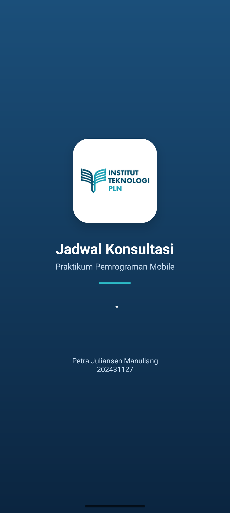
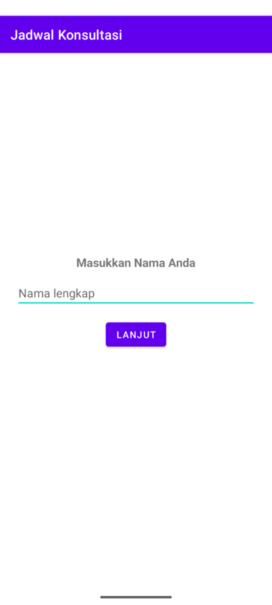
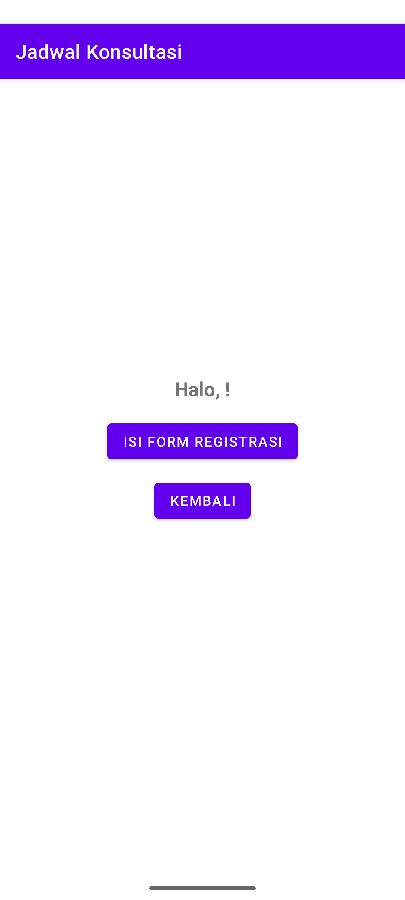
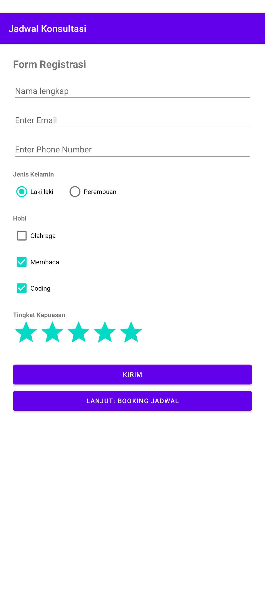
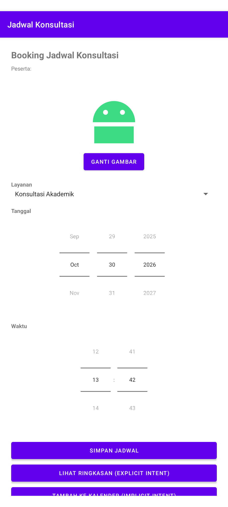
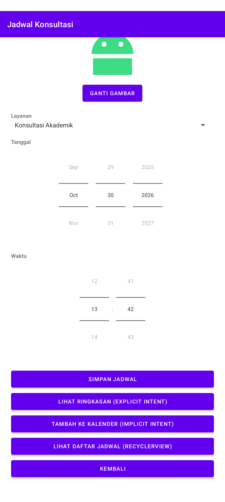
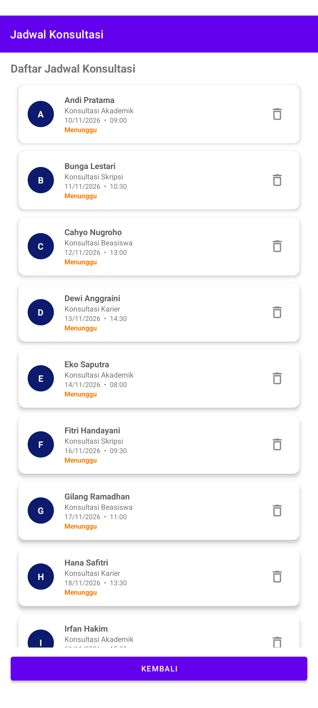
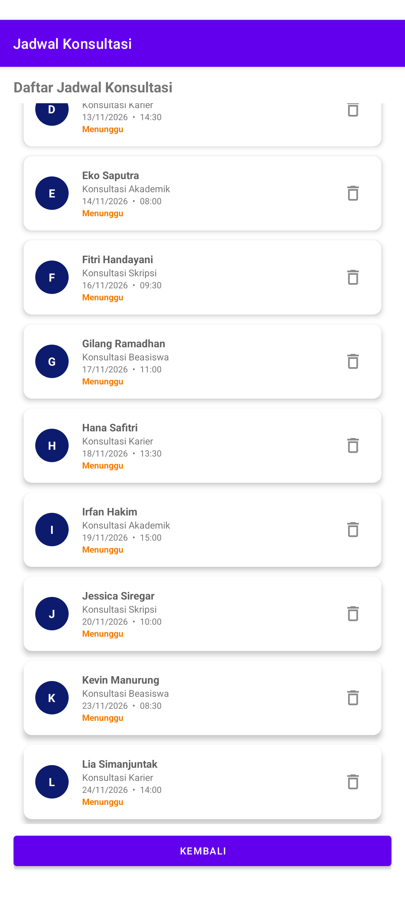

# Kuis Before UTS — Pemrograman Mobile (PRAK6)

| | |
|---|---|
| **Nama** | Petra Juliansen Manullang |
| **NIM** | 202431127 |
| **Mata Kuliah** | Pemrograman Mobile |
| **Kampus** | Institut Teknologi PLN |

Aplikasi **Jadwal Konsultasi** (Kotlin + XML Layout) yang menyelesaikan seluruh Activity dari modul pertemuan sebelumnya, ditambah ketentuan kuis: tombol RecyclerView di Jadwal Activity, daftar jadwal konsultasi dengan RecyclerView, dan splash screen.

## Checklist Ketentuan Kuis

| No | Ketentuan | Implementasi |
|---|---|---|
| 1 | Main Activity | `MainActivity.kt` — input nama, tombol Lanjut |
| 2 | Second Activity | `SecondActivity.kt` — sapaan nama, tombol Isi Form / Kembali |
| 3 | Form Activity | `FormActivity.kt` — EditText, RadioButton, CheckBox, RatingBar, tombol Booking Jadwal |
| 4 | Jadwal Activity | `JadwalActivity.kt` — Spinner layanan, DatePicker, TimePicker, explicit & implicit intent |
| 5 | Tombol **"LIHAT DAFTAR JADWAL (RECYCLERVIEW)"** di Jadwal Activity yang intent ke `DaftarJadwalKonsultasi` | `btnDaftarJadwal` di `activity_jadwal.xml` + `JadwalActivity.kt` |
| 6 | RecyclerView di activity baru, minimal 10 data Daftar Jadwal Konsultasi | `DaftarJadwalKonsultasi.kt`, `JadwalKonsultasiAdapter.kt`, `JadwalKonsultasi.kt`, `item_jadwal_konsultasi.xml` — **12 data** |
| 7 | Splash screen awal dengan desain sendiri | `SplashActivity.kt` + `activity_splash.xml` (logo ITPLN, gradasi biru, identitas) — activity LAUNCHER |

## Alur Aplikasi

```
SplashActivity → MainActivity → SecondActivity → FormActivity → JadwalActivity
                                                                   ├── RingkasanActivity (explicit intent)
                                                                   ├── Aplikasi Kalender (implicit intent)
                                                                   └── DaftarJadwalKonsultasi (RecyclerView)
```

## Struktur File Penting

```
app/src/main/
├── AndroidManifest.xml
├── java/com/example/prak6/
│   ├── SplashActivity.kt
│   ├── MainActivity.kt
│   ├── SecondActivity.kt
│   ├── FormActivity.kt
│   ├── JadwalActivity.kt
│   ├── RingkasanActivity.kt
│   ├── DaftarJadwalKonsultasi.kt
│   ├── JadwalKonsultasi.kt          (model data)
│   ├── JadwalKonsultasiAdapter.kt   (adapter RecyclerView)
│   └── EdgeToEdgeUtil.kt            (padding system bar agar judul tidak tertutup, targetSdk 36)
└── res/layout/
    ├── activity_splash.xml
    ├── activity_main.xml
    ├── activity_second.xml
    ├── activity_form.xml
    ├── activity_jadwal.xml
    ├── activity_ringkasan.xml
    ├── activity_daftar_jadwal_konsultasi.xml
    └── item_jadwal_konsultasi.xml
Screenshot/                          (hasil running program)
```

## Screenshot Hasil Running

| No | Halaman | Keterangan | Screenshot |
|---|---|---|---|
| 1 | Splash Screen | Layar awal desain sendiri: logo ITPLN, nama aplikasi, identitas |  |
| 2 | Main Activity | Input nama dan tombol Lanjut |  |
| 3 | Second Activity | Sapaan dan tombol Isi Form Registrasi / Kembali |  |
| 4 | Form Activity | Form registrasi: jenis kelamin, hobi, rating |  |
| 5 | Jadwal Activity | Booking jadwal: gambar, layanan, tanggal, waktu |  |
| 6 | Jadwal Activity (tombol) | Tombol baru **LIHAT DAFTAR JADWAL (RECYCLERVIEW)** |  |
| 7 | Daftar Jadwal Konsultasi | RecyclerView: data A–I |  |
| 8 | Daftar Jadwal Konsultasi (lanjutan) | Scroll sampai data terakhir: total 12 data (A–L) |  |
